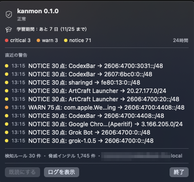
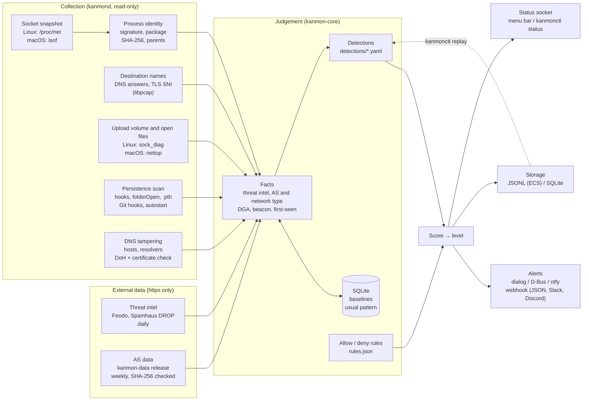

<div align="center">

# kanmon

**A per-process network monitor for macOS and Linux that you can teach new attack patterns yourself**

[](https://github.com/zephel01/kanmon/actions/workflows/ci.yml)
[](CHANGELOG.md)
[](LICENSE)


[日本語](README.md) | English

</div>

---

*Kanmon* (関門) is Japanese for a checkpoint gate, the place where travelers were inspected before passing through. kanmon is not a replacement for EDR or antivirus; it watches the **network chokepoint** those tools tend to cover thinly.

kanmon inspects every connection entering or leaving your machine and records two things:
- **which executable** made it: code signature, owning package, SHA-256, parent chain
- **where** it went

It then alerts you on suspicious traffic and **explains why** it flagged it. Detection rules are plain YAML, so you can respond to new techniques **without rebuilding**.

<p align="center">
  
  <br><sub>The macOS menu bar app (Kanmon.app; UI in Japanese). Click an alert to see the full explanation</sub>
</p>

> [!NOTE]
> The current release (v0.3) **observes and alerts only**. It does not block yet; blocking is the next milestone.
> Documentation beyond this page is currently in Japanese.

## Features
- 🔍 **Per-process attribution**: each connection is recorded with its executable, signature (Apple / Developer ID / ad-hoc / unsigned), owning package, SHA-256 and parent chain
- 🧩 **Rules as YAML**: write a rule, back-test it on past logs with `kanmonctl replay`, then drop it in place. The daemon hot-reloads it within 5 seconds
- 💬 **Alerts that explain themselves**: reasons, points, process and destination in full. Warnings and above stay on screen until you dismiss them. They can also go out via ntfy or webhooks (generic JSON, Slack, Discord)
- 🪤 **Persistence watch**: flags new or changed Claude Code hooks, VS Code folder-open tasks, `.pth` files, Git hooks, launch agents and similar dev-tool persistence (read-only)
- 📈 **Deviation from each process's usual pattern**: kanmon learns, per process, the destinations, hours, child processes and upload volume it usually has, and scores a process only when its pattern has been stable and it suddenly does something different. Browsers and other processes that visit new places every day are left out, so this is far quieter than flagging every first-seen destination
- 🛰️ **Destination network type**: kanmon looks up the destination's AS locally and tells cloud, CDN and residential networks apart. It scores non-browser processes connecting straight to residential IPs (such as hijacked home PCs used as proxies), connecting to bare IPs without a name lookup, or reaching an AS they have never used. The country is recorded but not used for scoring. The data is fetched weekly from [kanmon-data](https://github.com/zephel01/kanmon-data) (source: iptoasn.com)
- 🔬 **Package update inspection**: `kanmonctl inspect pypi:name==version` diffs a release against the previous one and looks for what stealers tend to add (`.pth` startup hooks, install scripts, environment harvesting, credential paths, hidden URLs, blockchain RPC endpoints, …). Nothing is executed or unpacked to disk
- 📦 **Upload volume**: judges how much was sent together with the files the process has open (`.env`, `.git` objects, GGUF, …) and the destination, so a model upload is told apart from exfiltration
- 📡 **Beacon detection**: statistical periodicity scoring catches C2 check-ins, including ones relayed through legitimate cloud services
- 🛡️ **Threat intel**: matches against Feodo Tracker, Spamhaus DROP and your own blocklists
- 🖥️ **Menu bar app (macOS)**: a shield icon whose color shows the state (green = OK, yellow = notice, red = alert, gray = daemon down). Click the counts to open a per-level list you can filter by rule. Alerts open in a detail window with the full text
- 🔒 **Hardened**: refuses rule files that are not owned by root, passes notification text as arguments so it cannot be injected, and supports an external dead-man heartbeat

## Quick start
Requires Rust 1.88 or later. On Linux you also need the libpcap headers (Ubuntu: `sudo apt install libpcap-dev`).

```bash
git clone https://github.com/zephel01/kanmon.git && cd kanmon
cargo build --release
sudo packaging/install-macos.sh     # macOS (launchd)
sudo packaging/install-linux.sh     # Linux (systemd)
```
To update, run `git pull`, `cargo build --release` and the install script again. The install script stops if the built binaries' version does not match the repository's, so a stale build is never installed.

Linux packages (.deb / .rpm) from the [releases](https://github.com/zephel01/kanmon/releases). They do not start the service automatically; review the config first, then enable it:
```bash
sudo apt install ./kanmon_0.4.0-1_amd64.deb        # Debian 12, Ubuntu 22.04 and later
sudo dnf install ./kanmon-0.4.0-1.x86_64.rpm       # Fedora, RHEL 9 family
sudo systemctl enable --now kanmond
```
Files: `/usr/sbin/kanmond`, `/usr/bin/kanmonctl`, config and rules in `/etc/kanmon` (your edits survive updates).

Menu bar app (macOS 13+, no sudo, starts at login):
```bash
macos/build-app.sh && macos/install-app.sh
```

To review alerts:
```bash
sudo kanmonctl alerts --file /Library/Logs/kanmon/events.jsonl   # macOS
sudo kanmonctl alerts                                            # Linux
```

For the first 7 days kanmon runs in **learning mode**: it builds a baseline of normal traffic and only notifies on `warn` and above.

## How it works

`kanmonctl inspect` (package update inspection) runs separately from kanmond and checks the diff it downloads from PyPI or npm with the same rule format (`70-inspect.yaml`).

## Example rule
```yaml
detections:
  - id: X1
    name: pkg_install_script_network
    points: 25
    description: Shell or downloader under a package manager reaches the internet
    kinds: [connect]
    when:
      all:
        - { field: network.scope, op: eq, value: internet }
        - { field: process.parent_chain, op: in, value: [npm, pip, pip3, uv, cargo] }
        - { field: process.name, op: in, value: [sh, bash, curl, wget] }
```
108 rules ship by default: general techniques (S1–S18), developer-targeted ones (D1–D12: remote-access tools, tunnels, exposed dev servers, network activity during package installs, exfiltration-friendly services, AI CLIs talking to unofficial endpoints, blockchain RPC endpoints, and more), DNS tampering (N1–N6: hosts file edits, resolver changes, DoH cross-check, and more), upload volume (V1–V9), persistence (P1–P7, PW), persistence-then-send correlation (C1, C2), deviation from the usual pattern (A1–A5), destination network type (R1, R2) and package update inspection (I1–I25, IC1–IC6). The rule syntax and the full list of fields rules can use are documented in [docs/detections.md](docs/detections.md) (Japanese).

## Check Python startup hooks (.pth)
As the November 2026 agent-framework compromise on PyPI showed, a single line in a `.pth` file runs code every time Python starts. List the ones on your machine (read-only):
```bash
kanmonctl scan --root ~/works --kind pth_exec
```
If `[読み込み: …]` (the module it imports) shows a name you don't recognize, check which package installed that `.pth` (`pip show -f <name>`). `_virtualenv`, `_distutils_hack` and `__editable__` are common and expected.

## Inspect a package update before installing it
```bash
kanmonctl inspect pypi:agent-framework==1.26.2 --detections /usr/local/etc/kanmon/detections
kanmonctl inspect npm:keyv@6.0.0 --detections /usr/local/etc/kanmon/detections
kanmonctl inspect --file ./pkg-1.1.whl --base-file ./pkg-1.0.whl --detections …   # local files, no network
```
It downloads the given version and the previous one from the registry (PyPI or npm), verifies their hashes, and reads only what was added. Exit code is 2 for warn and 3 for critical, so it can gate CI or an update. A single trait scores low; combinations such as "runs automatically + sends somewhere" score high. Details (Japanese): [docs/inspect.md](docs/inspect.md).

## Roadmap
- [x] **v0.1** Monitoring, detection and alerts on both OSes; YAML rules, replay, beacon scoring, threat intel
- [x] macOS menu bar app (Kanmon.app) and status socket
- [ ] Linux blocking (eBPF + NFQUEUE, pinned deny maps, fail-open/closed)
- [ ] macOS blocking (Network Extension, dynamic code-signature checks)
- [x] Domain names for destinations (passive DNS/SNI observation) and DNS tampering detection (hosts file, resolver settings, DoH cross-check)
- [ ] Exfiltration volume detection, newly-registered-domain feeds
- [ ] Web UI, syslog / SIEM integration

## Known limitations
- **Polling-based**: connections shorter than the poll interval (500 ms by default) can be missed
- Domain names come from observed DNS responses and TLS SNI, so **some connections stay unnamed** (QUIC, ECH-hidden SNI, names resolved before kanmon started, apps doing their own DNS over HTTPS)
- An attacker with root can disable kanmon. Configure `heartbeat_url` so an outside service notices when it stops
- Traffic in other network namespaces (containers) is not covered

## Contributing & security
- Issues and PRs are welcome. Tests must only target RFC 5737 documentation addresses, localhost, or hosts you own
- Report vulnerabilities privately as described in [SECURITY.md](SECURITY.md)

## License
[Apache License 2.0](LICENSE)
