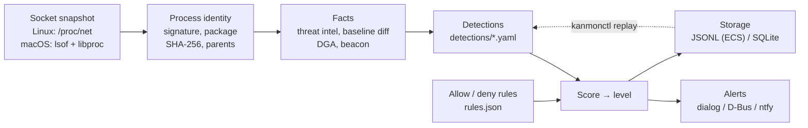

<div align="center">

# kanmon

**A per-process network monitor for macOS and Linux that you can teach new attack patterns yourself**

[](https://github.com/zephel01/kanmon/actions/workflows/ci.yml)
[](CHANGELOG.md)
[](LICENSE)


[日本語](README.md) | English

</div>

---

*Kanmon* (関門) is Japanese for a checkpoint gate, the place where travelers were inspected before passing through. kanmon is not a replacement for EDR or antivirus; it watches the **network chokepoint** those tools tend to cover thinly.

kanmon inspects every connection entering or leaving your machine and records two things:
- **which executable** made it: code signature, owning package, SHA-256, parent chain
- **where** it went

It then alerts you on suspicious traffic and **explains why** it flagged it. Detection rules are plain YAML, so you can respond to new techniques **without rebuilding**.

> [!NOTE]
> v0.1 **observes and alerts only**. It does not block yet; blocking is the next milestone.
> Documentation beyond this page is currently in Japanese.

## Features
- 🔍 **Per-process attribution**: each connection is recorded with its executable, signature (Apple / Developer ID / ad-hoc / unsigned), owning package, SHA-256 and parent chain
- 🧩 **Rules as YAML**: write a rule, back-test it on past logs with `kanmonctl replay`, then drop it in place. The daemon hot-reloads it within 5 seconds
- 💬 **Alerts that explain themselves**: reasons, points, process and destination in full. Warnings and above stay on screen until you dismiss them
- 📡 **Beacon detection**: statistical periodicity scoring catches C2 check-ins, including ones relayed through legitimate cloud services
- 🛡️ **Threat intel**: matches against Feodo Tracker, Spamhaus DROP and your own blocklists
- 🖥️ **Menu bar app (macOS)**: a shield icon whose color shows the state (green = OK, yellow = notice, red = alert, gray = daemon down). Alerts open in a detail window with the full text
- 🔒 **Hardened**: refuses rule files that are not owned by root, passes notification text as arguments so it cannot be injected, and supports an external dead-man heartbeat

## Quick start
Requires Rust 1.88 or later.

```bash
git clone https://github.com/zephel01/kanmon.git && cd kanmon
cargo build --release
sudo packaging/install-macos.sh     # macOS (launchd)
sudo packaging/install-linux.sh     # Linux (systemd)
```

Menu bar app (macOS 13+, no sudo, starts at login):
```bash
macos/build-app.sh && macos/install-app.sh
```

To review alerts:
```bash
sudo kanmonctl alerts --file /Library/Logs/kanmon/events.jsonl   # macOS
sudo kanmonctl alerts                                            # Linux
```

For the first 7 days kanmon runs in **learning mode**: it builds a baseline of normal traffic and only notifies on `warn` and above.

## How it works


## Example rule
```yaml
detections:
  - id: X1
    name: pkg_install_script_network
    points: 25
    description: Shell or downloader under a package manager reaches the internet
    kinds: [connect]
    when:
      all:
        - { field: network.scope, op: eq, value: internet }
        - { field: process.parent_chain, op: in, value: [npm, pip, pip3, uv, cargo] }
        - { field: process.name, op: in, value: [sh, bash, curl, wget] }
```
30 rules ship by default: general techniques (S1–S18) and developer-targeted ones (D1–D8: remote-access tools, tunnels, exposed dev servers, network activity during package installs, and more). The rule syntax and the full list of fields rules can use are documented in [docs/detections.md](docs/detections.md) (Japanese).

## Roadmap
- [x] **v0.1** Monitoring, detection and alerts on both OSes; YAML rules, replay, beacon scoring, threat intel
- [x] macOS menu bar app (Kanmon.app) and status socket
- [ ] Linux blocking (eBPF + NFQUEUE, pinned deny maps, fail-open/closed)
- [ ] macOS blocking (Network Extension, dynamic code-signature checks)
- [ ] DNS attribution (domain names, DoH bypass detection)
- [ ] Exfiltration volume detection, newly-registered-domain feeds
- [ ] Web UI, syslog / SIEM integration

## Known limitations (v0.1)
- **Polling-based**: connections shorter than the poll interval (500 ms by default) can be missed
- Destinations are **IP-only**; no domain names yet
- An attacker with root can disable kanmon. Configure `heartbeat_url` so an outside service notices when it stops
- Traffic in other network namespaces (containers) is not covered

## Contributing & security
- Issues and PRs are welcome. Tests must only target RFC 5737 documentation addresses, localhost, or hosts you own
- Report vulnerabilities privately as described in [SECURITY.md](SECURITY.md)

## License
[Apache License 2.0](LICENSE)
