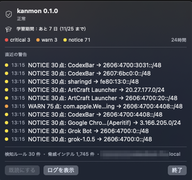
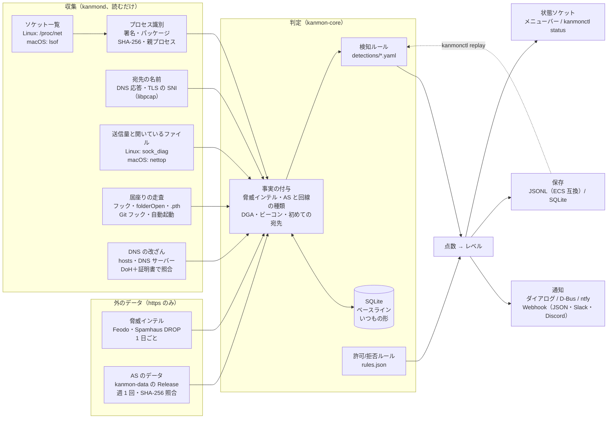

<div align="center">

# kanmon（関門）

**新しい手口に自分で追いつける、macOS / Linux 向けのプロセス単位の通信監視ツール**

[](https://github.com/zephel01/kanmon/actions/workflows/ci.yml)
[](CHANGELOG.md)
[](LICENSE)


日本語 | [English](README.en.md)

</div>

---

関門（kanmon）は、関所のように「通るものを改める門」のことです。EDR やウイルス対策の置き換えではなく、それらが手薄になりやすい**通信の出入口**を見る役割です。
kanmon は端末から出入りする通信を 1 本ずつ調べて、次の 2 つを記録します。
- **どの実行ファイルが通信したか**：署名、パッケージ、ハッシュ、親プロセス
- **どこへ通信したか**

そのうえで、怪しい通信は**理由付きで**知らせます。判定ルールは YAML で書けるので、新しい手口が出てきても**再ビルドせずに**自分で対応できます。

<p align="center">
  
  <br><sub>macOS のメニューバーアプリ（Kanmon.app）。行をクリックすると、理由付きの詳細を表示します</sub>
</p>

> [!NOTE]
> 今の版（v0.3）は**監視と通知だけ**で、通信の遮断はまだしません。遮断はロードマップの次の段階です。

## 特徴
- 🔍 **プロセス単位で見る**：通信ごとに、実行ファイル・署名（Apple / Developer ID / ad-hoc / 未署名）・所有パッケージ・SHA-256・親プロセスの列を記録します
- 🧩 **ルールは YAML**：書く → `kanmonctl replay` で過去ログに当てて確かめる → 置く、で反映されます。デーモンは 5 秒以内に読み直します
- 💬 **なぜ止めたかが分かる通知**：理由・点数・プロセス・宛先を全文で表示します。warn 以上は閉じるまで残ります。ntfy・Webhook（汎用 JSON・Slack・Discord）で外にも送れます
- 📡 **ビーコン検知**：C2 によくある「一定周期の通信」を統計で拾います。正規のクラウドを経由した C2 にも効きます
- 🪤 **居座りの検知**：Claude Code のフック、VS Code の自動実行タスク、`.pth`、Git のフック、自動起動など、開発ツールへの仕込みの追加・変更を知らせます（読むだけ）
- 📈 **いつもの形との違い**：プロセスごとに「いつも使う宛先・時間帯・起動する子・送信量」を覚え、形が安定しているのに違う動きをしたときに点数を付けます。毎日新しい宛先へ行くブラウザなどは対象にしないので、「初めての宛先」だけで判定するより誤検知が少なくなります
- 🛰️ **宛先の回線の種類**：宛先の AS を手元のデータで引き、クラウド・CDN・住宅用回線を見分けます。ブラウザ以外が住宅用回線（踏み台にされた PC など）へ直接つなぐ、名前を引かずに IP へ直結する、いつもと違う AS へつなぐ、といった形に点数を付けます。国は記録するだけで判定には使いません。データは週 1 回、[kanmon-data](https://github.com/zephel01/kanmon-data) から取ります（元データは iptoasn.com）
- 🔬 **パッケージの更新の検査**：`kanmonctl inspect pypi:名前==版` で、前の版からの差分に盗む処理によく出る形（`.pth`・導入時のスクリプト・環境変数の収集・認証ファイル・隠した URL・ブロックチェーンの RPC 等）がないかを調べます。コードは実行も展開もしません
- 📦 **送信量の検知**：送った量を、開いているファイル（`.env`・`.git` の中身・GGUF 等）と宛先と合わせて判定します。モデルのアップロードのような正当な大量送信と、持ち出しを分けます
- 🛡️ **脅威インテル**：Feodo Tracker・Spamhaus DROP・ローカルの拒否リストと照合します
- 🖥️ **メニューバーアプリ（macOS）**：盾のアイコンの色で状態が分かります（緑＝正常、黄＝注意、赤＝警告、灰＝停止）。件数を押すとレベル別の一覧が開き、ルールで絞り込めます。警告は詳細ウィンドウで全文を表示します
- 🌐 **ブラウザで履歴を見る**：`kanmonctl web`（Mac はメニューの「ブラウザ」）で、警告の履歴（期間・レベル・ルール・文字列で絞り込み、日ごとの件数）、プロセスごとの通信相手、親子のプロセスの「つながり」（どの親から起動され、どこへつないだか）を見られます。このマシンの 127.0.0.1 だけで待ち受ける読み取り専用の画面です
- 🔒 **自分の身も守る**：root 所有でないルールは読みません。通知は引数で渡すので注入できません。外部の死活監視とも連携できます

## クイックスタート
Rust 1.88 以上が必要です。Linux では libpcap の開発用ファイルも必要です（Ubuntu：`sudo apt install libpcap-dev`）。

**macOS**
```bash
git clone https://github.com/zephel01/kanmon.git && cd kanmon
cargo build --release
sudo packaging/install-macos.sh
```

**Linux（systemd）**
```bash
git clone https://github.com/zephel01/kanmon.git && cd kanmon
cargo build --release
sudo packaging/install-linux.sh
```
更新するときも同じく `git pull` → `cargo build --release` → 導入スクリプトの順です。導入スクリプトは、ビルドした実行ファイルの版がリポジトリの版と違えば止まります（古いものを入れないため）。

設定ファイルは更新で上書きしません。v0.5.6 からログの既定は「日付ごとに 14 日、前の日は gzip」ですが、v0.5.5 までに入れた環境では設定に `rotate = "size"` が残っています。日付ごとにするには、設定（macOS は `/Library/Application Support/kanmon/etc/kanmon.toml`、Linux は `/etc/kanmon/kanmon.toml`）の `[jsonl]` を `rotate = "daily"`・`keep_days = 14` に変え、kanmond を再起動します。

**Linux のパッケージ（.deb・.rpm）**
[リリース](https://github.com/zephel01/kanmon/releases)から取って入れます。自動では起動しないので、設定を見てから有効にします。
```bash
sudo apt install ./kanmon_0.4.0-1_amd64.deb        # Debian 12・Ubuntu 22.04 以降
sudo dnf install ./kanmon-0.4.0-1.x86_64.rpm       # Fedora・RHEL 9 系
sudo systemctl enable --now kanmond
```
`/usr/sbin/kanmond`・`/usr/bin/kanmonctl`・設定とルールは `/etc/kanmon`（書き換えた設定は更新で上書きしない）。

**メニューバーアプリ（macOS 13 以降）**
```bash
macos/build-app.sh && macos/install-app.sh   # sudo 不要。ログイン時に自動起動
```

警告を見るには次を実行します。
```bash
sudo kanmonctl alerts --file /Library/Logs/kanmon/events.jsonl   # macOS
sudo kanmonctl alerts                                            # Linux
```

導入直後の 7 日間は**学習期間**です。この間は普段の通信を覚え、warn 以上だけを通知します。

## 仕組み

`kanmonctl inspect`（パッケージの更新の検査）は kanmond とは別に動き、PyPI・npm から取った差分を同じ検知ルールの書き方（`70-inspect.yaml`）で調べます。

## 検知ルールの例
```yaml
detections:
  - id: X1
    name: pkg_install_script_network
    points: 25
    description: パッケージ導入処理の配下から外部へ通信
    kinds: [connect]
    when:
      all:
        - { field: network.scope, op: eq, value: internet }
        - { field: process.parent_chain, op: in, value: [npm, pip, pip3, uv, cargo] }
        - { field: process.name, op: in, value: [sh, bash, curl, wget] }
```
同梱ルールは 109 件です。一般的な手口（S1〜S18）、開発者を狙う手口（D1〜D12：遠隔操作ソフト、トンネル、開発サーバーの公開、パッケージ導入時の通信、持ち出し先のサービス、AI CLI の非公式な宛先、ブロックチェーンの RPC など）、DNS の改ざん（N1〜N6：hosts の書き換え、DNS サーバーの変更、DoH での照合など）、送信量（V1〜V9）、居座り（P1〜P7・PW）、仕込みと送信の結び付け（C1・C2）、いつもの形との違い（A1〜A5）、宛先の回線の種類（R1・R2）、パッケージの更新の検査（I1〜I25・IC1〜IC6）を含みます。書き方と、ルールから参照できるフィールドは [docs/detections.md](docs/detections.md) にあります。

## Python の起動の仕掛け（.pth）を確かめる
2026 年 11 月の agent-framework（PyPI）のように、`.pth` に 1 行足すだけで Python の起動のたびにコードが動きます。手元の `.pth` は次で一覧にできます（読むだけ）。
```bash
kanmonctl scan --root ~/works --kind pth_exec
```
`[読み込み: …]` に見覚えのないモジュール名があれば、その `.pth` を入れたパッケージ（`pip show -f <名前>`）を確かめてください。`_virtualenv`・`_distutils_hack`・`__editable__` 等はよくあるものです。

## パッケージの更新を入れる前に調べる
```bash
kanmonctl inspect pypi:agent-framework==1.26.2 --detections /usr/local/etc/kanmon/detections
kanmonctl inspect npm:keyv@6.0.0 --detections /usr/local/etc/kanmon/detections
kanmonctl inspect --file ./pkg-1.1.whl --base-file ./pkg-1.0.whl --detections …   # 手元のファイル（ネットワークを使わない）
```
指定した版と 1 つ前の版をレジストリ（PyPI・npm）から取り、ハッシュを照合してから、増えた部分だけを読みます。終了コードは warn で 2、critical で 3 なので、CI や更新の前の確認に使えます。1 つの特徴だけでは点数は低く、「勝手に動く仕掛け＋外への送り先」のような組み合わせで重くなります。詳しくは [docs/inspect.md](docs/inspect.md)。

## ブラウザで履歴を見る
```bash
kanmonctl web            # ブラウザが開きます。Ctrl-C で終わります（sudo は不要）
kanmonctl web --no-open  # URL を表示するだけ
```
Mac ではメニューバーの「ブラウザ」でも開けます（30 分使わなければ自動で終わります）。画面は 3 つです。
- 履歴：警告の一覧と日ごとの件数。行を押すと、理由・プロセス・親・相手（AS・国・回線の種類）と元の JSON を出します
- プロセス：実行ファイルごとに、通信した相手を回数の多い順に出します
- つながり：親子のプロセスの木に、各プロセスの接続先・待受・受けた接続をぶら下げます。親の行には、その下で出た最も重い警告のレベルが付きます

このマシンの 127.0.0.1 だけで待ち受け、起動のたびに作るトークンが無いと開けません（Host ヘッダーも確かめます）。外部のサイトからは何も読みません。データは kanmond の状態ソケットから取るので、見られるのはソケットに許された利用者（root とログイン中の利用者）だけです。kanmon は通信したプロセスだけを記録するので、通信しなかったプロセスは祖先として名前だけ出ます。

## ログを共有する（記事・Issue 向け）
Mac ではメニューバーの「書き出す…」から、IP・ホスト名・ユーザー名・ホームのパス・コマンドの引数を伏せて書き出せます。期間・レベル・ドメインの伏せ方を選び、プレビューで確かめてから「表をコピー」（Markdown の集計表）か「保存…」（伏せたログ）を押します。伏せる処理は kanmond の中で行うので、アプリに生の値は渡りません。

コマンドでは次のとおりです（Linux も同じ）。
```bash
sudo kanmonctl export --summary                  # 集計の表（Markdown）。IP・ドメイン・パスは出ない
sudo kanmonctl export --hours 24 > shared.jsonl  # 伏せたログ。--domains mask でドメインも全部伏せる
```
同じ値には同じ記号（`IP-1`・`host-1`・`USER-1` 等）が付きます。ループバックと文書用の IP はそのまま残します。伏せるのは決まった形の値だけなので、プロジェクト名を含むファイル名などは残ります。共有する前に中身を見てください。

## ドキュメント
| 文書 | 内容 |
|---|---|
| [docs/detections.md](docs/detections.md) | 検知ルールの書き方、フィールド一覧、同梱ルール |
| [docs/configuration.md](docs/configuration.md) | 設定、CLI、許可/拒否ルール、保存先 |
| [docs/inspect.md](docs/inspect.md) | パッケージの更新の検査（`kanmonctl inspect`）の仕組み・特徴・点数 |
| [docs/design-v1.md](docs/design-v1.md) | 設計書（脅威モデル・アーキテクチャ・ロードマップ） |
| [CHANGELOG.md](CHANGELOG.md) | 変更履歴 |

## ロードマップ
- [x] **v0.1** 両 OS の監視・検知・通知、YAML ルール、replay、ビーコン、脅威インテル
- [x] macOS メニューバーアプリ（Kanmon.app）と状態ソケット
- [ ] Linux での遮断（eBPF + NFQUEUE、拒否マップのピン留め、フェイルオープン/クローズの切替）
- [ ] macOS での遮断（Network Extension、実行中プロセスの署名検証）
- [x] 宛先のドメイン名（DNS 応答・SNI の受け身の観測）と DNS の改ざん検知（hosts・DNS サーバー設定・DoH での照合）
- [ ] 送信量の急増検知、新規登録ドメイン（NRD）フィード
- [ ] Web UI、syslog / SIEM 連携

## 既知の限界
- **ポーリング方式**なので、収集間隔（既定 500ms）より短い接続は取りこぼすことがあります
- ドメイン名は DNS 応答と SNI から付けるので、**名前が分からない接続**があります（QUIC、ECH で SNI が隠れた接続、kanmon の起動前に引かれた名前、DNS over HTTPS を自前で使うアプリ）
- root を取られた後は止められてしまいます。`heartbeat_url` で外側から死活を監視してください
- コンテナや別の network namespace の通信は対象外です

## コントリビュート
- Issue・PR を歓迎します。開発ルールは [CLAUDE.md](CLAUDE.md) にあります（テストの宛先は RFC 5737 の文書用 IP に限る、など）
- 脆弱性は公開 Issue ではなく、[SECURITY.md](SECURITY.md) の手順で報告してください

## ライセンス
[Apache License 2.0](LICENSE)
