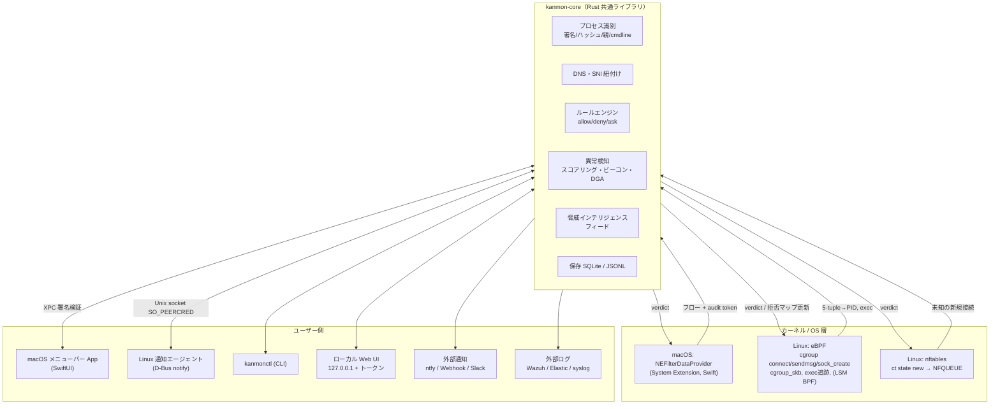
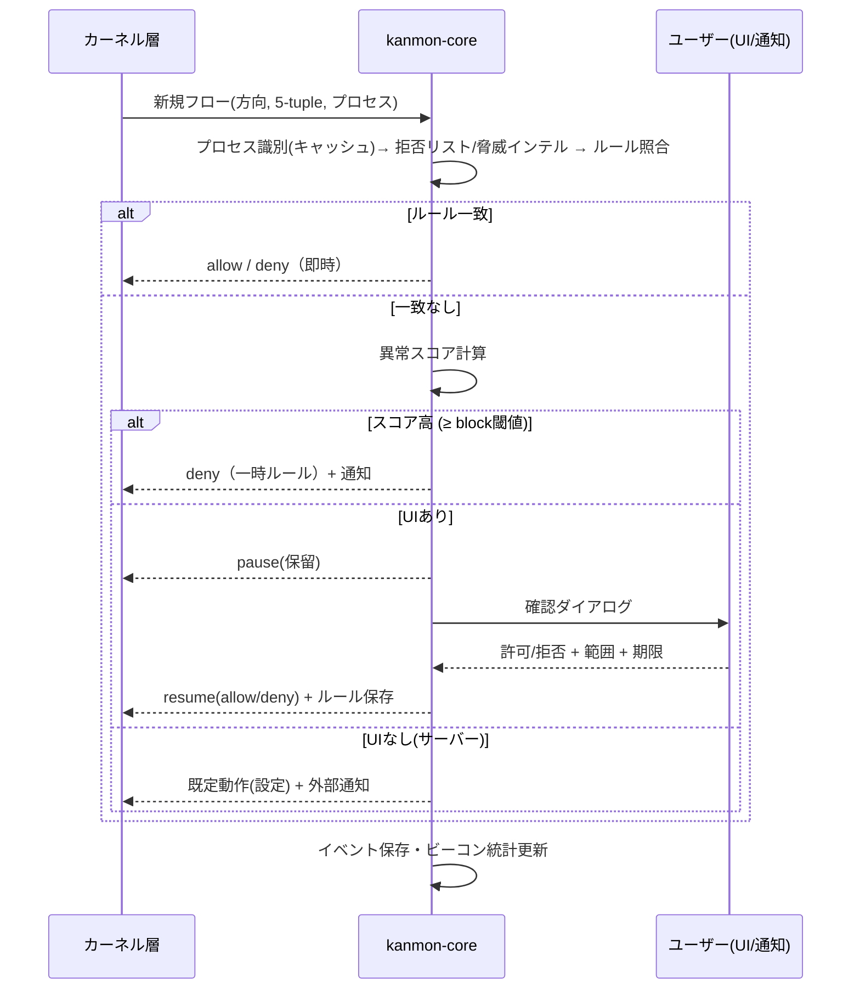

# 通信監視ソフト「kanmon」設計書 v1（macOS / Linux）

作成：2026-11-18（JST） 対象：個人の macOS・Linux 端末（EDR との併用を想定）
名称：**kanmon**（関門。旧仮称 kanmon）

> 表記：【確認】＝公開資料・ソースで確かめた事実／【推測】＝筆者の推定・未検証。【要検証】＝実装前に実機で確かめる項目。
> 本書は防御用ソフトの設計書であり、攻撃コードは含まない。テスト手順も自分の管理下の環境・ドメインだけを使う。

---

## 0. 要約（最初に読むところ）

1. **やること**：プロセス単位で外向き・内向きの通信を捕まえ、「どの実行ファイルが（署名・ハッシュ・親）」「どこへ（ドメイン・IP・ポート）」を記録し、ルールで許可/拒否/確認。ルールに当たらない「おかしい」通信はスコアで通知またはブロック。
2. **macOS**：LuLu と同じく **Network Extension の `NEFilterDataProvider`（System Extension 形式）** でフローを止めて判定。プロセスは audit token → コード署名（Team ID / 署名ID）で識別。内向きは LuLu が捨てている inbound フローも扱う。
3. **Linux**：**eBPF（cgroup/connect・sendmsg・sock_create・cgroup_skb・exec 追跡）で帰属と既知ルールの即時判定**、未知の新規接続だけ **nftables → NFQUEUE** でユーザー空間に上げて確認待ちにする二段構え。拒否リストは bpffs にピン留めし、デーモンが落ちても効き続ける。
4. **共通コア**：ルールエンジン・スコアリング・ビーコン検知・保存は **Rust の共通ライブラリ（kanmon-core）**。macOS 拡張は Swift 必須なので FFI で呼ぶ。
5. **「おかしい」の検知**：未署名/新規バイナリ、/tmp 等からの通信、異常な親子関係、**ビーコン周期性スコア**、新規ドメイン/DGA らしさ、脅威インテリジェンス一致、ベースラインとの差分、予期しない listen ポート。合計スコアで「記録/通知/確認/自動遮断」。
6. **限界の明言**：root を取られた後は止められない（無効化・回避され得る）。正規クラウド（Cloudflare・Microsoft 等）経由の C2 は宛先だけでは見分けにくく、「どのプロセスが・どんな周期で」で補う。ECH/DoH でドメインが見えない通信が増えている。
7. **既存 OSS の流用**：LuLu・OpenSnitch とも **GPLv3**、Little Snitch for Linux の公開部分は **GPLv2**（中核バックエンドは非公開）。自分用なら流用自由だが、配布・公開するなら GPL 継承。設計の参考にとどめて新規実装を推奨（理由は §19）。

---

## 1. 参考にした既存製品の仕組み（調査結果）

### 1.1 LuLu（Objective-See、macOS、GPLv3）
調査対象：GitHub `objective-see/LuLu` 最新コミット 2d5bdf0（2026-11-02 11:07 +0100 ＝ 2026-11-02 19:07 JST）と公式ページ。

| 項目 | 内容 | 根拠 |
|---|---|---|
| 構成 | `LuLu.app`（UI・メニューバー）＋ **System Extension**（`Extension/`、root で動く判定本体）。両者は XPC で通信 | 【確認】ソースのディレクトリ構成 |
| フィルタ方式 | `NEFilterDataProvider` のサブクラス（`FilterDataProvider.m`）。`NEFilterSettings` に「全外向き（`NETrafficDirectionOutbound`）を filterData」のルールとループバック用ルールを入れ、既定は allow | 【確認】`FilterDataProvider.m` 97–146行 |
| 判定 | `handleNewFlow:` で allow / drop / **pause**（ユーザーの回答待ち）。回答後に `resumeFlow` で再開。同一プロセスの後続フローは「related」としてまとめて保留 | 【確認】同 208–330行 |
| 内向き | `NETrafficDirectionOutbound` 以外は**無視**（コメント「outbound で初期化したのに inbound が来ることがある」）。公式 FAQ も「LuLu は外向きのみ監視」 | 【確認】同 250行、公式ページ |
| プロセス識別 | `flow.sourceAppAuditToken` → `SecCodeCopyGuestWithAttributes`（audit token）で動的コード取得 → `SecCodeCheckValidity`、署名ID・Team ID・証明書チェーン、「Apple 署名 / Developer ID / App Store」判定 | 【確認】`Process.m`、`Shared/signing.m` |
| ルールモデル | キー：プロセスパス＋署名情報（csInfo）、宛先（アドレス/ホスト、正規表現可）、ポート、プロトコル、action、scope（プロセス全体 or 宛先限定）、期限（常に／プロセス存続中／指定時刻まで）。種別：default（OS 必須）、apple、baseline（導入時に既存アプリ）、user、passive | 【確認】`Shared/Rule.h`、公式ページ |
| リスト | 許可リスト・拒否リスト（ローカルファイル or URL、日次更新）。ルールより優先。拒否リスト優先 | 【確認】公式ページ |
| ホスト名 | 優先順：`flow.URL.host` → `flow.remoteHostname`（macOS 11+）→ `remoteEndpoint.hostname`。**Network.framework / NSURLSession を使わないアプリ（例：Chrome）はホスト名が取れず IP のみ** | 【確認】`getBestHostnameFromFlow`、公式ページの注記 |
| モード | Passive（通知せず既存ルール適用、新規は許可/拒否を選択）、Block（全遮断）、プロファイル切替 | 【確認】公式ページ |
| UI 不在時 | 回答できるクライアントがいなければ「許可＋passive ルール作成」（＝**フェイルオープン**） | 【確認】`allowNoClient:` |
| 補助 | 親プロセス（hierarchy）表示、VirusTotal（ハッシュを URL に入れてブラウザで開くだけ）、Netiquette 同梱 | 【確認】公式ページ |
| IPC 認証 | XPC 接続時に相手の audit token から署名要件を検証 | 【確認】`XPCListener.m` 120–150行 |
| エンタイトルメント | `com.apple.developer.networking.networkextension = content-filter-provider-systemextension`、`com.apple.developer.system-extension.install`（App 側）、App Group | 【確認】`*.entitlements` |
| 限界 | 「Network Extension を経由しない通信は見えず、止められない」と公式が明記 | 【確認】公式ページ |

### 1.2 Little Snitch（Objective Development）
- **macOS 版**（有償・非公開）：接続アラート、Silent Mode（まず許可し後で判断）、**署名ベースのプロセス識別**（パス識別もオプション）、ルールグループ購読・プロファイル自動切替（Wi-Fi に応じて）、**双方向（外向き・内向き）ルール**、ブロックリスト（IP ベース含む）、DNS 暗号化（DoH/DoT/DoQ、Quad9 等）、トラフィック履歴最大12か月、CLI（設定変更・ルール出力・アラート応答・ログ）。【確認】公式製品ページ
- 内部方式は非公開。Linux 版の公式説明に「macOS 版はホスト名の復元に**ディープパケットインスペクション**を使う」とある。【確認】→ NEFilterDataProvider で先頭データ（TLS ClientHello の SNI、平文 DNS）を覗いていると読むのが自然。【推測】
- **Linux 版**（2026-04-08 公開、無料、v1.1.1 は 2026-10-26）：【確認】
  - eBPF（Rust/aya）＋ Rust バックエンド＋ Web UI（`http://localhost:3031/`）。カーネル 6.12 以上・BTF 必須。
  - 公開リポジトリの eBPF フック：`cgroup_sock(sock_create/sock_release)`、`cgroup_sock_addr(connect4/6, sendmsg4/6)`、`cgroup_skb`（ingress/egress）、`fentry/fexit bprm_execve` 等で exec 追跡、tracepoint。【確認】`obdev/littlesnitch-linux` の `ebpf/src`
  - **公式が「セキュリティツールではない（プライバシー用）」と明言**。eBPF のマップ容量・命令数制限のため、テーブルを溢れさせれば回避でき、ホスト名の対応付けはヒューリスティック。【確認】
  - ライセンス：eBPF・共通部・Web UI は GPLv2、ルール管理等のバックエンドは非公開。【確認】
- → **本設計への示唆**：Linux で eBPF だけに頼ると「溢れたら素通り」になる。セキュリティ目的なら、未知の通信は **NFQUEUE で確実に止める経路**と、**マップが溢れたら拒否側に倒す**作りが必要。

### 1.3 OpenSnitch（Linux、GPLv3）
- Go のデーモン（`opensnitchd`）＋ Python/Qt の UI、gRPC で通信。【確認】リポジトリ構成
- 遮断：nftables/iptables で `ct state new` の最初のパケットを **NFQUEUE** に送り、ユーザーの応答まで保留（コメント「Connections are queued until the user denies/accept them, or reaches a timeout」）。キュールールは `bypass` 付き（デーモン不在時は素通り＝フェイルオープン）。【確認】`daemon/firewall/nftables/rules.go`
- 帰属：eBPF の `kprobe/tcp_v4_connect`・`udp_sendmsg` 等で 5-tuple→PID、exec/exit を tracepoint で追跡、DNS は `uprobe getaddrinfo` と DNS 応答のキュー取得。eBPF が使えなければ /proc 走査。【確認】`ebpf_prog/*.c`
- ルール期限：once / until restart / always 等。【確認】`daemon/rule/rule.go`

---

## 2. 目的と脅威モデル

### 2.1 目的
- 端末上の**どのプロセスが**、**どこと**通信しているかを常時記録・可視化する。
- 許可していない外向き通信（C2・情報持ち出し・不要なテレメトリ）と、予期しない内向き通信（勝手に開いた待受ポートへの接続）を**通知・遮断**する。
- EDRが「端末内の振る舞い」を見るのに対し、kanmon は「**通信の出入口**」を見る。役割を重ねず補完する。

### 2.2 守るもの（想定する攻撃）
| 想定 | kanmon の効きどころ |
|---|---|
| 一般ユーザー権限で動くマルウェア・ローダー（EDR 回避のため見た目を変えたもの含む） | 見た目が変わっても「未知の実行ファイルが外へ出る」時点で確認・遮断 |
| 侵害された正規アプリ/サプライチェーン（npm/pip のインストールスクリプト等） | 「そのアプリが普段行かない宛先」をベースライン差分で検知 |
| 正規クラウド経由の C2（Cloudflare Workers、Azure、GitHub 等） | 宛先は正規でも「このプロセスが」「一定周期で」通信する点をビーコンスコアで拾う |
| 情報持ち出し | 送信量の急増、普段と違う宛先国・ASN |
| 勝手に開いた待受（リバースシェルの待受、デバッグポート放置、開発サーバーの 0.0.0.0 bind） | 内向き新規 listen の検知と接続ブロック |

### 2.3 守らないもの・限界（設計上の前提）
- **root（管理者）を取られた後**：kanmon の停止・ルール改ざん・カーネル層の回避が可能。kanmon は「取られる前の C2 確立を止める」「止められたことを外部に知らせる（死活監視）」までが役割。
- **カーネル／ファームウェアレベルの侵害**、NE/eBPF を経由しない経路（macOS では NE を通らない通信があると LuLu 公式が明記）。
- **許可済みプロセスへのコード注入**（ブラウザ等に入り込んで通信）：プロセス識別ではすり抜ける。ビーコン・宛先差分で部分的に補う。EDR の領分。
- **暗号化された中身の検査**：TLS の中身は見ない（MITM はしない）。SNI・DNS・メタデータまで。ECH（Encrypted Client Hello）普及で SNI も見えなくなる方向。
- 物理アクセス・他端末（ルーター等）の通信。

---

## 3. 全体アーキテクチャ



### 判定の流れ（共通）



---

## 4. OS 別のカーネル/拡張層

### 4.1 macOS

| 部品 | 採用 | 理由 |
|---|---|---|
| フロー遮断 | **`NEFilterDataProvider`（content-filter, System Extension）** | Apple 公認の唯一の現実的手段（kext は非推奨）。LuLu・Little Snitch と同じ土台。新規フローで allow/drop/pause、必要なら先頭データを覗ける |
| 外向き | `NENetworkRule(remoteNetwork:nil, direction:.outbound)` → `.filterData` | LuLu と同じ |
| **内向き** | `direction:.inbound` のルールも登録し、`NEFilterSocketFlow.direction == .inbound` を処理（LuLu は捨てている） | 内向き監視の要件。【要検証】inbound の TCP 受け入れがどの時点で見えるか（accept 前か後か）、UDP の扱い |
| 先頭データ | 必要時のみ `filterDataVerdict(withFilterInbound:false, peekInboundBytes:0, filterOutbound:true, peekOutboundBytes:N)` で TLS ClientHello の SNI を取得 | Chrome 等で `remoteHostname` が空でもホスト名を得る。常時はやらない（性能） |
| DNS 紐付け | 第1段：`flow.URL.host`/`remoteHostname`。第2段：UDP/TCP 53 フローの応答を覗いて IP→名前キャッシュ。第3段（任意）：`NEDNSProxyProvider` か自前 DoH スタブ | §8 参照。DNS Proxy は他の VPN/セキュリティ製品と競合しやすいので任意 |
| プロセス情報 | `sourceAppAuditToken` → `SecCode*`（署名）、`proc_pidpath`、`proc_pidinfo`/`sysctl(KERN_PROCARGS2)`（親 PID・引数） | LuLu と同じ API。ES を使わずに済む |
| exec 追跡（任意・後期） | **Endpoint Security**（`NOTIFY_EXEC`/`FORK`/`EXIT`） | 短命プロセスの親子関係を正確に取れる。ただし `com.apple.developer.endpoint-security.client` は **Apple への申請・承認が必要**、フルディスクアクセスも要る。MVP では使わない |
| 待受ポート列挙 | `proc_pidinfo(PROC_PIDLISTFDS)` → `proc_pidfdinfo(PROC_PIDFDSOCKETINFO)` を数秒〜数十秒ごと | listen 状態の新規ソケットを検知（ポーリング） |

【推測】EDR の macOS センサーも自前のネットワークフィルタを持つため、複数の content filter が共存する形になる。macOS は複数のフィルタを順に通す動作と理解しているが、順序・相互影響は【要検証】。

### 4.2 Linux：方式比較と採用

| 方式 | できること | 強み | 弱み |
|---|---|---|---|
| **eBPF cgroup/connect4/6・sendmsg4/6** | connect()/UDP 送信時にプロセス文脈で許否（同期） | プロセス帰属が正確、カーネル内で即時拒否 | プログラム内で待てない＝**ユーザーに聞けない**。マップ容量制限 |
| eBPF cgroup/sock_create | ソケット作成時（raw socket 等の検知） | raw/packet socket の作成を把握 | 宛先はまだ不明 |
| eBPF cgroup_skb ingress/egress | パケット単位の許否・計量 | 送受信量・内向き | プロセス文脈が弱い |
| **LSM BPF**（`socket_connect`/`socket_bind`/`socket_listen`/`socket_accept`） | LSM フックで許否 | cgroup 外や全プロセスに効く、listen/bind も止められる | `CONFIG_BPF_LSM` と起動パラメータ `lsm=...,bpf` が必要（ディストリ差）。待てない点は同じ |
| **nftables + NFQUEUE** | 新規接続の最初のパケットをユーザー空間で保留し判定 | **ユーザー確認まで待てる**、成熟、OpenSnitch 実績 | パケットにプロセス情報がない（eBPF で補う）、デーモン停止時の挙動（bypass 有無）設計が要る、性能は eBPF より劣る |
| fanotify | ファイルアクセス監視 | 実行ファイルの書き換え検知→ハッシュキャッシュ無効化 | **通信の監視手段ではない**（補助用途のみ） |
| /proc 走査・netlink sock_diag | 現在の接続・listen の列挙 | 依存が少ない | 事後的・取りこぼし（短命接続） |

**採用：二段構え（eBPF ＋ NFQUEUE）**
1. **eBPF（aya / Rust）**：
   - `cgroup_sock_addr connect4/6, sendmsg4/6` で **(cookie, 5-tuple) → (pid, tgid, exe の inode/dev, cgroup id)** をリングバッファで通知し、同時に **カーネル内判定マップ**（確定した allow/deny、宛先 IP と実行ファイル ID の組）を引いて即時に拒否/許可。
   - `cgroup_sock sock_create` で raw / packet socket の作成を記録（ICMP トンネル等の検知材料）。
   - `fentry/fexit bprm_execve`（無い環境は tracepoint `sched_process_exec`）と `sched_process_exit` でプロセス表（親 PID・exe・argv）を維持。
   - `cgroup_skb` で送受信バイト数を計量（持ち出し検知用）。
2. **nftables（専用テーブル `inet kanmon`）**：
   - `output`：`ct state new` かつ **eBPF が「確定」マークを付けていない**接続 → `queue num 0-3 fanout`。
   - `input`：`ct state new` → 同様に queue（内向き）。ループバックは既定で除外可。
   - デーモンが判定し、決まった結果は eBPF マップと conntrack mark に書き戻す（次から同じ組はカーネル内で即決）。
3. **LSM BPF（使える環境のみ、フェーズ3）**：`socket_listen`/`socket_bind` で予期しない待受を検知・拒否、`socket_connect` を保険として二重化。
4. **フェイルセーフ**：拒否マップは `/sys/fs/bpf/kanmon/` にピン留め → **デーモンが落ちても既存の拒否は効き続ける**。NFQUEUE の `bypass` 有無は端末の種類で切替（§10）。
5. **マップ溢れ対策**：帰属マップが溢れて帰属できない接続は「unattributed」として NFQUEUE 側で扱い、設定に応じ拒否側に倒す（Little Snitch Linux が「溢れたら回避できる」と認めている弱点への対策）。

対応カーネル目標：5.15 以上（Ubuntu 22.04 相当）を最低線、6.1 以上推奨。Little Snitch Linux が 6.12 を要求した原因は検証器の命令数上限とのことなので【確認】、eBPF 側は「帰属と単純なマップ照合」に絞り、判定ロジックはユーザー空間に置く。

---

## 5. デーモンと言語

| 部品 | 言語 | 理由 |
|---|---|---|
| kanmon-core（ルール・スコア・保存・フィード） | **Rust** | メモリ安全（root で外部入力＝パケット/DNS/フィードを解析するため重要）、性能、macOS/Linux 共通化、Little Snitch Linux も Rust 採用で実績あり |
| Linux eBPF | **Rust（aya）** | ユーザー空間と型共有、CO-RE/BTF 対応。C（libbpf）でも可だがツールチェーン統一を優先 |
| Linux デーモン `kanmond` | Rust（tokio）＋ `nfq` crate、`nftables` は netlink（`rustables` 等）か `nft -j` | 【要検証】crate の成熟度。最悪 `nft` コマンド呼び出しで MVP |
| macOS System Extension | **Swift**（必須：NetworkExtension は Swift/ObjC API） | kanmon-core を静的ライブラリにして **FFI（uniffi or swift-bridge or C ABI）** で呼ぶ。判定はコールバック内で同期的に終わらせる |
| macOS UI | SwiftUI（メニューバー App） | アラート・ルール画面 |
| Linux 通知エージェント | Rust（`zbus` で org.freedesktop.Notifications、アクションボタン付き） | GNOME/KDE で許可/拒否ボタン |
| Web UI | Rust（axum）＋ 静的フロント（TypeScript） | ヘッドレスサーバー・Mac から Linux を見る用 |
| CLI `kanmonctl` | Rust | 両 OS 共通 |

macOS の root 常駐部分は **System Extension 1つに集約**（LuLu と同じ構成）。別の launchd デーモンは作らない（攻撃面と承認手順を増やさないため）。

---

## 6. プロセス識別

### 6.1 識別子（優先順）
| 層 | macOS | Linux |
|---|---|---|
| 1. 暗号学的同一性 | **Team ID ＋ 署名ID（designated requirement）**。Apple 署名 / Developer ID / App Store / ad-hoc / 未署名を区別 | パッケージ管理下か（dpkg/rpm の所有＋ `dpkg --verify` 相当のハッシュ一致）、または **SHA-256** |
| 2. 実体 | 実行ファイルパス＋ cdhash | exe のパス（`/proc/pid/exe`）＋ (dev, inode, mtime) ＋ SHA-256 |
| 3. 文脈 | 親プロセス鎖（pid→ppid を数段）、cmdline、ユーザー、TTY 有無 | 同左＋ cgroup（systemd unit 名、コンテナ ID） |
| 4. インタプリタ | `python3`/`node`/`osascript`/`bash` 等は**スクリプトパス（argv[1]）まで含めて識別** | 同左。`/proc/pid/cmdline` |

### 6.2 方針
- ルールは既定で **層1（署名/パッケージ）** に紐付け（アップデートで壊れない、移動・リネームに強い：Little Snitch・LuLu と同じ考え）。署名が無いものは **ハッシュ固定**（変われば新規扱い＝再確認）。
- インタプリタ問題：`node` 全体を許可すると任意の npm スクリプトが通るので、**インタプリタは「インタプリタ＋スクリプト」単位**でルール化を既定に。
- ハッシュ計算は初回のみ・非同期。キャッシュキーは (dev, inode, mtime, size)。Linux は fanotify `FAN_CLOSE_WRITE`/`FAN_MODIFY` で、macOS は FSEvents で書き換えを検知してキャッシュ無効化。
- 「消された実行ファイル」（Linux の `/proc/pid/exe` が `(deleted)`、memfd 由来）は**強い異常シグナル**。
- 短命プロセス：Linux は exec 追跡で親子を保持。macOS は MVP では接続時点の ppid のみ（取得前に親が終了すると欠ける）→ ES 導入で改善。

---

## 7. ルールエンジン

### 7.1 評価順
1. **組み込み保護ルール**（kanmon 自身の更新・必須 OS 通信、ループバック等。ユーザー無効化は警告付きで可）
2. **拒否リスト（脅威インテリジェンス・ユーザー拒否リスト）** — 許可ルールより優先（LuLu と同じ「拒否リスト優先」）
3. **ユーザールール**（具体的なものが優先：プロセス＋宛先＋ポート ＞ プロセス＋宛先 ＞ プロセス全体。同順位なら deny 優先）
4. **異常スコアによる自動判定**（§9）
5. **既定動作**（モード別：確認 / 許可＋記録 / 拒否）

### 7.2 ルールの条件
- 方向：`outbound` / `inbound` / `both`
- 範囲：`internet` / `lan`（RFC1918・ULA・リンクローカル・mDNS）/ `loopback` / 任意 CIDR
- 宛先：ドメイン（完全一致・サフィックス `*.example.com`・正規表現は上級者向け）、IP/CIDR、ASN（任意）、国（任意、GeoIP）
- ポート・プロトコル（tcp/udp/icmp/any）、内向きはローカルポート
- ユーザー（uid）、cgroup/コンテナ（Linux）
- 有効期限：`once`（この接続のみ）/ `process`（プロセス存続中）/ `until`（日時）/ `duration`（例 1h）/ `always`
- プロファイル：自宅・外出（Wi-Fi SSID・ネットワーク判定で自動切替。Little Snitch 方式）

### 7.3 モード
| モード | 新規通信 | 用途 |
|---|---|---|
| **学習（Learning）** | 許可して「提案ルール」を蓄積、スコア高のみ通知 | 導入後 3〜7 日。ベースライン作成 |
| **確認（Interactive）** | 保留して確認ダイアログ | デスクトップ通常運用 |
| **静観（Silent）** | 許可して記録、後で一覧から確定（Little Snitch の Silent Mode） | 会議中・作業集中時 |
| **厳格（Strict）** | 拒否して通知 | 不審時・公衆 Wi-Fi |
| **全遮断（Lockdown）** | 許可リスト以外すべて拒否 | 侵害が疑われるとき（ワンクリック隔離） |

ルールは「使用回数・最終使用日時」を持ち、90 日使われない許可ルールは整理候補として提示（Little Snitch の「冗長/無効ルールの指摘」に相当）。

---

## 8. DNS・SNI との紐付け

**目的**：IP だけでは CDN/クラウドで意味が薄いので、「どのドメイン名として接続したか」を得る。

| 手段 | macOS | Linux | 備考 |
|---|---|---|---|
| OS が渡すホスト名 | `flow.URL.host`/`remoteHostname`（Network.framework/NSURLSession のみ） | なし | LuLu の制約と同じ |
| DNS 応答の観測 | 53 番フローの応答を覗いて IP→名前（TTL 付き） | nftables で `udp sport 53` 応答を queue（OpenSnitch 方式）か eBPF で解析 | プロセスごとに「直前に引いた名前」と突合 |
| libc 解決のフック | — | uprobe `getaddrinfo`（OpenSnitch 方式） | glibc 限定。Go 静的バイナリ等は不可 |
| **SNI** | 先頭データを覗いて ClientHello 解析 | NFQUEUE で TCP 最初のデータパケットを解析（ct で1回だけ） | ECH で見えなくなる |
| **自前 DNS スタブ（推奨・フェーズ2）** | `127.0.0.1:53` で kanmon が DoH/DoT 上流へ転送し、システム DNS をそこへ向ける | systemd-resolved の上流 or `/etc/resolv.conf` を kanmon スタブへ | 名前→IP の対応を確実に保持＋暗号化 DNS（Little Snitch の DNS 暗号化相当）＋ DNS 段階で拒否リスト適用 |

**DoH（アプリ独自の DNS over HTTPS）対策**
- 既知の DoH エンドポイント（公開リスト：Cloudflare `1.1.1.1`/`cloudflare-dns.com`、Google `8.8.8.8`/`dns.google`、Quad9 等）への 443 接続と、853（DoT/DoQ）を「**DNS 迂回**」としてタグ付け。ブラウザ以外のプロセスなら異常スコア加点、設定で拒否。
- Firefox は `use-application-dns.net` カナリアドメインで DoH を無効化できる（kanmon スタブが NXDOMAIN を返す）。Chrome は OS の DNS 設定に従う挙動が既定。【要検証】各ブラウザの最新挙動。
- 正規クラウド上の DoH（独自サーバー）は判別不能 → 「DNS を引かずに直接 IP へ行く通信」自体を加点対象にする。

---

## 9. 「おかしいもの」の検知ロジックとスコアリング

### 9.1 シグナルと点数（初期値。運用で調整）
| # | シグナル | 点 | 判定方法 |
|---|---|---|---|
| S1 | 脅威インテリジェンス一致（IP/ドメイン/JA3 等） | **100（即遮断）** | §9.4 のフィード |
| S2 | 未署名・ad-hoc 署名（macOS）／パッケージ管理外（Linux） | 20 | §6 |
| S3 | 初めて見る実行ファイル（ハッシュ新規、作成 24h 以内） | 15 | 初見時刻 |
| S4 | 一時・ユーザー書込領域から実行（`/tmp`、`/var/tmp`、`/dev/shm`、`~/Downloads`、`/private/var/folders`、`~/Library/Caches` 等） | 25 | パス |
| S5 | 実行ファイルが削除済み／memfd／隠しファイル（`.` 始まり） | 35 | /proc、パス |
| S6 | 異常な親子関係（Office/PDF/ブラウザ/メール → シェル/スクリプトインタプリタ → 通信、`launchd` 直下の未知、`sshd`→ 想定外） | 25 | 親鎖パターン表 |
| S7 | **ビーコン周期性スコア**（§9.2） ≥ 0.8 | 30（0.6〜0.8 は 15） | 統計 |
| S8 | 新規ドメイン（登録 30 日以内 = NRD フィード） | 20 | フィード |
| S9 | DGA らしさ（§9.3） | 15 | 文字列特徴 |
| S10 | IP 直打ち（DNS を引いていない）で非 LAN、かつブラウザ以外 | 10 | §8 |
| S11 | 非標準ポート（443/80/53/853 以外）でインターネットへ、かつプロセスの過去実績なし | 10 | ベースライン |
| S12 | ベースライン差分：このプロセスが**初めて行く**ドメイン/ASN/国 | 10 | ベースライン |
| S13 | 送信量の急増（プロセス×宛先の送信バイトが過去 p99 の 10 倍超） | 20 | cgroup_skb / NE データ量 |
| S14 | DNS 迂回（既知 DoH/DoT へブラウザ以外が接続） | 15 | §8 |
| S15 | 内向き：予期しない新規 listen（0.0.0.0/:: bind、ベースライン外ポート） | 25 | §9.5 |
| S16 | 内向き：インターネット側からの新規接続受信（ルール外） | 30 | 方向＋範囲 |
| S17 | raw/packet socket 作成（root でない管理ツール以外） | 20 | sock_create |
| S18 | 動的 DNS・トンネル系ドメイン（duckdns、ngrok、trycloudflare 等）※正規利用もあるので加点のみ | 10 | 静的リスト |

減点：Apple 署名・ディストリ公式パッケージ（-15）、ユーザーが過去に同種を許可（-10）。

### 9.1b 宛先の AS と回線の種類（v0.5.1）
- 国や IP の評判だけでは判断しない。踏み台の PC（住宅用回線のプロキシ）を国内に置かれると、国の判定は当てにならない。国は `destination.geo.country_iso_code` に記録するだけで、同梱ルールは点数に使わない。IP の脅威インテル（S1）は「当たれば加点」だけで、外れても減点しない。
- 見るのは「どんな回線か」：R1（ブラウザ・P2P 以外が住宅用回線の IP へ直接、+25）。外へ出る通信の宛先は、クラウド・CDN・正規のサービスが普通で、住宅用回線へ直接つなぐ常駐・CLI は珍しい。ビデオ会議・VPN・P2P（`p2p_apps`）は除く。
- 「名前を引かずに IP へ直結」：R2（+10）。名前の観測（DNS・SNI）が動いていて、起動から 5 分たっているとき（`kanmon.names_active`）だけ。DoH を使うアプリもあるので単独では記録だけ。
- いつもの AS：A5（安定したプロセスが初めての AS へ、+10）。正規のサービスを使う持ち出しは宛先では区別できないので、「誰が使っているか」と組で見る。
- データ：iptoasn.com の `ip2asn-combined.tsv`（PDDL v1.0）。利用者が各自取ると運営者の負荷になるので、kanmon-data リポジトリの CI が週 1 回だけ取り、範囲・AS 番号・国（名前は一覧にある AS だけ）に縮めた KASN1（gzip で約 3MB）を Release に置く。kanmond は 7 日ごと（端末ごとに最大 1 日ずらす）に `.sha256` だけを取り、変わっていれば本体を取って SHA-256・形式・件数を確かめる。合わなければ前回分を使う。
- 一覧（`cloud_asns`・`cdn_asns`・`residential_asns`）は網羅していない。一覧に無い AS は `unknown` で点は付かない。住宅用の AS にも企業向け・データセンターが混ざる【要検討：誤検知の実数で見直す】。
- 実測（2026-11-19）：元データ 11MB（gzip）、v4 約 41 万・v6 約 9 万の範囲（まとめた後）、AS 約 8.7 万。KASN1 は展開後 9.0MB・gzip 3.2MB。読み込み約 50ms、照合 100 万回で約 0.2 秒。

### 9.2 ビーコン周期性スコア（RITA の考え方を簡略化）
単位：(プロセス同一性, 宛先＝登録ドメイン or /24) ごとに、直近 24h の接続開始時刻列 t₁…tₙ（n≥6）。
- 間隔 Δᵢ = tᵢ₊₁ − tᵢ
- **規則性**：`s_ts = 1 − min(1, MAD(Δ)/median(Δ))`（ジッタに強いよう MAD を使用）
- **歪み**：Bowley 歪度 `b = (Q3+Q1−2·Q2)/(Q3−Q1)` → `s_skew = 1 − |b|`
- **データサイズの一定性**：送信バイト列で同様に `s_ds`
- **継続性**：観測窓のうち接続があった時間帯（1h 単位）の割合 `s_cov`
- **総合**：`beacon = 0.35·s_ts + 0.15·s_skew + 0.25·s_ds + 0.25·s_cov`
- 除外：OS/アプリの既知の定期通信（更新確認、NTP、プッシュ通知）は学習期間のベースラインで減点。ジッタ付き C2（例：60s±30%）でも中央値と MAD で 0.5〜0.7 程度は出る想定【推測、テストで調整】。
- 計算は 5 分ごとのバッチ（判定経路には載せない）。閾値超え → 通知＋「そのプロセスを確認モードに格上げ」。

### 9.3 DGA らしさ
- 登録ドメインのラベル部分で：シャノンエントロピー、子音連続長、数字比率、英語/日本語ローマ字 bigram の対数尤度、長さ。
- 単純ロジスティック合成で 0〜1。誤検知が多い（CDN のハッシュ風サブドメイン）ので **登録ドメイン（eTLD+1）単位**で評価、上位サイト一覧（Tranco 等）にあれば除外。
- NXDOMAIN 多発（プロセスが 1 分に 10 件以上 NXDOMAIN）は DGA の強い兆候 → +20（自前 DNS スタブがある場合のみ取得可）。

### 9.4 脅威インテリジェンスフィード（無料・自動更新）
| フィード | 内容 | 備考 |
|---|---|---|
| abuse.ch Feodo Tracker | ボットネット C2 の IP | 商用利用条件は各サイトで確認 |
| abuse.ch URLhaus / ThreatFox | 悪性 URL・ドメイン・IoC | API キー要の場合あり【要検証】 |
| Spamhaus DROP/EDROP | 乗っ取られた/犯罪用ネットワーク | |
| NRD（新規登録ドメイン）リスト | 30 日以内の登録 | 提供元により条件差 |
| ユーザー独自リスト | ローカルファイル or URL | LuLu と同形式（改行区切り）も読めるようにする |
- 更新は日次、**署名/ハッシュ検証＋TLS 証明書検証**（Little Snitch Linux が 2026-10 に rustls の証明書検証不備を修正した例のとおり、フィード取得経路も攻撃面）。
- フィードはルールの前段で照合（§7.1 の 2）。誤検知時のために「この一致を無視」をワンクリックで。

### 9.5 内向き（待受）監視
- 待受一覧のスナップショット（ポート、bind アドレス、プロセス）をベースラインと比較。
- 新規 listen：`127.0.0.1` のみ → 記録、`0.0.0.0`/`::`/LAN IP → 通知（S15）、インターネット到達可能（グローバル IP 直結・UPnP）→ 高スコア。
- 内向き接続：ルールが無ければ「LAN からは確認、インターネットからは拒否」を既定。macOS は既存のアプリケーションファイアウォール（内向き）とも併用可。

### 9.5b プロセスごとの「いつもの形」（v0.5.0）
「初めての宛先」だけでは、更新のたびに宛先が変わるアプリや、毎日新しいサイトへ行くブラウザで誤検知になる（実機で確認）。そこで、**形が安定しているプロセスで違いが出たとき**だけを「いつもと違う」とする（`kanmon_core::profile`、`detections/45-profile.yaml`）。
- 見る形：宛先（登録ドメイン。名前が分かるインターネットの宛先だけ。CDN の IP は変わるので IP では見ない）、動く時間帯（0〜23 時）、親 → 子（どの親がどの子を起動して通信したか）、送信量（10 分の最大）。
- 安定：観測を始めてから `min_age_days`（3）以上、知っている宛先が `max_dests`（30）以下、最後に新しい宛先が増えてから `quiet_days`（2）以上。親子は、子の種類が `max_children`（10）以下の親だけ。時間帯は観測 `hour_min_age_days`（7）日以上。送信量は `volume_min_mb`（10MB）以上で、これまでの最大（無ければ報告の下限）の 10 倍以上。
- 点数：A1 初めての宛先 20、A2 いつもと違う子（シェル・ダウンロード用のコマンド）25、A2b いつもと違う子 10、A3 送信量 25、A4 時間帯 10。どれも単独では通知（30）に届かないか、届いても notice にとどめ、他の特徴と重なったときに上がる。
- 学習期間中・起動時の既存の接続は記録するだけ。署名が同じでも proc_key が変わる（未署名で SHA-256 が変わる）と形は作り直しになる。
- 宛先の国・ネットワーク（ASN）は、地理情報のデータを持たないので見ない【要検討】。

### 9.6 スコアから動作へ
| 合計 | 動作（確認モード） | ヘッドレス |
|---|---|---|
| 0–29 | 通常処理（ルール/既定動作）＋記録 | 同左 |
| 30–59 | 確認ダイアログに「注意」表示＋理由一覧 | 許可＋外部通知（低優先度） |
| 60–99 | 確認ダイアログを**既定「拒否」**で表示、タイムアウトで拒否 | 拒否（一時ルール 1h）＋外部通知（高優先度） |
| ≥100 | 即遮断＋通知（ユーザーは後で解除可） | 同左 |

通知には必ず「**なぜ止めたか（該当シグナルと点数）**」を出す。誤検知を学習に返す（「この理由では今後減点」）。

---

## 10. 通知とブロックの動作

### 10.1 保留とタイムアウト
- 確認待ちの保留：既定 **30 秒**。期限切れ時は「**今回だけ拒否**（ルールは作らない）」。アプリは再試行するので、ユーザーが後で許可すれば通る。
- 同一プロセスの後続フローはまとめて保留（LuLu の related flow 方式）し、ダイアログは 1 つ。
- ダイアログ：プロセス名・パス・署名者（Team ID）・親プロセス鎖・宛先（ドメイン/IP/国/ASN）・ポート・異常スコアと理由・VirusTotal で見る（ハッシュのみ、ブラウザで開くだけ＝LuLu 方式）。選択肢：許可/拒否 × 範囲（この宛先/このドメイン全体/全宛先）× 期限（1回/プロセス中/1時間/永久）。
- 【要検証】macOS の pause 中フローに OS 側の上限時間があるか（Apple ドキュメントに明記を確認できず）。

### 10.2 フェイルセーフ（オープン）/フェイルクローズ
| 状況 | デスクトップ（macOS/Linux） | ヘッドレス Linux サーバー |
|---|---|---|
| UI 不在・未ログイン | 既定動作（設定）：**ルール外は許可＋高スコアのみ拒否**。LuLu は全面許可（フェイルオープン）だが、本設計はスコア≥60 を拒否する点が違う | 同左 |
| デーモン停止・クラッシュ | macOS：拡張が落ちた場合の OS 挙動は【要検証】（フィルタ不在で素通りと推測）→ 再起動＋死活通知。Linux：NFQUEUE を **bypass なし（フェイルクローズ）** を既定 | **bypass あり（フェイルオープン）** を既定（SSH 締め出し防止）。ただしピン留めした eBPF 拒否マップは有効のまま |
| 判定の内部エラー | 許可＋記録＋エラー通知 | 同左 |
| 自分を締め出さない | 管理接続（SSH の指定ポート・指定元）は組み込み許可ルール | 必須 |

### 10.3 通知チャネル
- **macOS**：メニューバー App のアラートウィンドウ（確認用）、`UNUserNotificationCenter`（情報通知）。
- **Linux デスクトップ**：ユーザーセッションの通知エージェントが D-Bus 通知（アクション：許可/拒否/詳細）。詳細はローカル Web UI へ。
- **ヘッドレス/外部**：**ntfy**（自前サーバー推奨）、汎用 Webhook（JSON）、Slack/Discord Webhook、メール（任意）。
  - 外部通知は**情報のみ**を既定。リモートで「許可」を押せる機能は攻撃面になるので既定無効。有効化する場合は「1回限り・短期限・署名付きトークン」で、kanmon からの**外向きポーリング**（受信ポートを開けない）方式に限定。
- 通知の抑制：同一（プロセス×理由）は 10 分に 1 回まで、夜間はまとめ（ダイジェスト）。

### 10.4 遮断で守る約束（過剰な遮断で使われなくならないために）
一般向けのセキュリティ製品で「通信がやたら止められて作業にならず、機能を切るか使うのをやめた」という例は多い。原因の多くは、HTTPS を途中で開いて検査する機能と、効かない例外だった。遮断を入れても、次を崩さない。

1. **HTTPS の中身を開けない。** 証明書の差し替え（TLS の中間者）はしない。宛先の名前は DNS の応答と TLS の挨拶（SNI）を横から読むだけ（§8）。
   - 理由：通信を開いて検査する製品では、自己署名の証明書の NAS・ルーターの管理画面・自分のサイトに入れなくなる報告が多い。例外に入れても証明書の差し替えは止まらず、機能ごと切るしかなかった例もある【利用者の報告】。検査で「証明書が信頼できない発行元・期限切れ・名前の不一致」なら止める製品もある【公式】
2. **応答を溜めない。止めるかどうかは接続の最初で決める。** NFQUEUE で保留するのは新しい接続の最初のパケットだけで、判定が出たら以降は流す（ct mark で既知にする）。中身は見ない。
   - 理由：応答を最後まで受け取ってから検査する方式では、ストリーミングの応答（ビルドログ・LLM の応答等）がいつまでも終わらない【公式：Vercel の KB】
3. **ループバックと LAN（RFC 1918・リンクローカル・ULA）は既定で止めない。** 止める対象の既定はインターネット宛てだけ。ローカルの LLM サーバー・NAS・ルーター・開発サーバーを妨げない。LAN も止めたい場合は設定で明示する。
4. **例外（許可ルール）は、本当にすべての検査から外す。** 許可ルールに一致した通信は、どの遮断にも掛けない（記録はする）。これをハーネスで確かめる。
   - 理由：例外に入れても直らず、結局機能を切ったという不満が最も多い【利用者の報告】
5. **なぜ止めたかと、「今回だけ許可」をすぐ出す。** 通知に理由・点数・プロセス・宛先を全文で出し（現在の通知と同じ）、許可のボタンを付ける。「疑わしい接続を遮断」だけの通知にしない。
6. **新しいルール・変えたルールは、いきなり止めない。** まず「記録だけ」で動かし（既定 3 日）、`kanmonctl replay` で誤検知を確かめてから止める側に回す。ルールの更新でまとめて誤遮断が起きないようにする。
   - 理由：更新をきっかけに誤遮断がまとめて起きた例がある【利用者の報告・ベンダーは同日に修正したと回答】

あわせて、§15 のとおり、EDR を使っている端末では、HTTPS を開いて検査する別の製品を重ねない（どちらが止めたか切り分けられない）。kanmon は通信の経路に入らないので、観察だけなら EDR と干渉しない。

---

## 11. UI
| UI | 機能 |
|---|---|
| macOS メニューバー | 現在の通信・最近の拒否・モード切替（学習/確認/静観/厳格/全遮断）・プロファイル切替 |
| ルール画面 | 一覧・検索（Little Snitch Linux 風のクエリ `exe:` `host:` `port:` `-` 除外）、使用回数、期限、提案ルール |
| 接続履歴 | プロセス別・ドメイン別・国別の階層表示、送受信量グラフ、ビーコン候補一覧 |
| `kanmonctl` | `status`、`rules list/add/rm/export/import`、`events tail --json`、`mode set`、`answer <id> allow --scope domain --for 1h`、`lockdown on/off`（要認証） |
| ローカル Web UI | `127.0.0.1:<port>` のみ bind、起動時生成トークン＋ CSRF 対策、HTTPS は不要（ループバック）。リモートで見るときは SSH ポートフォワード経由（直接公開しない） |

---

## 12. ログと保存
- **SQLite（WAL）**：`events`（接続イベント）、`rules`、`processes`（識別キャッシュ・初見時刻）、`baselines`（プロセス×宛先の統計）、`beacon_stats`、`feeds`。保持：接続イベント 90 日（設定可）、集計は 12 か月。
- **JSONL**：`/var/log/kanmon/events.jsonl`（Linux）、`/Library/Logs/kanmon/`（macOS）。ローテーション付き。
- **外部送信**：syslog（RFC5424）、Wazuh/Elastic が取り込みやすい **ECS 互換フィールド名**（`process.executable`、`destination.domain` 等）。端末外に送ることで、侵害後にローカルログを消されても残る。
- プライバシー：URL のパスやクエリは保存しない（ホスト名まで）。

---

## 13. 自己防御
| 対策 | macOS | Linux |
|---|---|---|
| 設定・ルールの保護 | `/Library/Application Support/kanmon/`（root:wheel 0600）。ルールファイルに HMAC（鍵は Keychain の System 領域） | `/etc/kanmon/`（root 0600）、`/var/lib/kanmon/`。HMAC 鍵は root 専用ファイル（TPM は将来） |
| 改ざん検知 | 起動時と定期的に HMAC 検証、不一致→全遮断ではなく「最後の正常版に戻す＋高優先度通知」 | 同左＋ fanotify で設定ファイル変更を監視 |
| IPC 認証 | XPC 接続元の audit token から**コード署名要件（自分の Team ID）を検証**（LuLu と同方式） | Unix ドメインソケット（0660, group `kanmon`）＋ `SO_PEERCRED` で uid/pid 検証。ルール変更系は uid 0 か polkit 認証 |
| 停止・無効化の検知 | 拡張が無効化されたら UI App が検知して通知 | systemd `WatchdogSec`、`Restart=always` |
| **死活監視（デッドマンスイッチ）** | 両 OS：外部 ntfy/Webhook に 5 分ごとのハートビート。**途絶を外側（別サーバーや ntfy のスケジュール）で検知**すれば、root で止められた場合も気づける |
| 自分自身の通信 | 更新確認・フィード取得のみ。宛先固定・証明書ピン留め（フィードは署名検証） | 同左 |
| 停止・アンインストール | 管理者認証必須（LuLu と同様） | `kanmonctl` は root、操作は監査ログへ |

root 取得後は上記すべて回避され得る（§2.3）。死活監視は「止められたことに気づく」ための最後の線。

---

## 14. 性能目標
| 指標 | 目標 |
|---|---|
| 既知フロー（キャッシュ一致）の判定遅延 | Linux カーネル内 < 10µs、NFQUEUE 経由 < 1ms（p99）、macOS `handleNewFlow` < 1ms（p99） |
| 未知フロー（スコア計算込み、確認なし） | < 5ms（p99）。ハッシュ計算は非同期、初回は署名/パスで仮判定 |
| 常駐 CPU | アイドル < 0.5%、ビルド時など 1,000 新規接続/秒で < 5%（1コア換算） |
| メモリ | < 150MB（イベントキャッシュ・統計込み） |
| 処理能力 | 新規接続 5,000/秒（Linux）で取りこぼし 0（溢れたら §4.2-5 の扱い） |
| ディスク | 1 日あたり < 100MB（重複接続は集約） |
| 起動 | 起動前の通信の取りこぼしを最小化：Linux は nftables テーブルをネットワーク起動前に適用（systemd `Before=network-pre.target`） |

---

## 15. EDR との共存上の注意
- **役割分担**：EDR＝端末内の振る舞い・マルウェア検知（EDR/NGAV）。kanmon＝通信の出入口の可視化・制御。kanmon は検知結果を EDR に送らない（連携 API は上位プランが前提と推測）。
- **macOS**：EDR のセンサーも System Extension とネットワークフィルタを持つ。【推測】複数の content filter は共存できるが、両方が pause/drop すると原因切り分けが難しい → kanmon のログに「kanmon が拒否した」ことを明確に残す。導入直後に通信不安定なら、まず kanmon を Passive にして切り分け。
- **Linux**：EDR の Linux センサーは eBPF（ユーザーモード）またはカーネルモジュールで動く。eBPF プログラムの同居自体は可能だが、**同じ cgroup フックへの多重アタッチ順序**（`BPF_F_ALLOW_MULTI`）と、どちらかが拒否すれば拒否になる点を理解しておく。【要検証】EDR のバージョンと動作モード。
- **相互の誤検知**：kanmon の eBPF ロード・nftables 変更・プロセス列挙は、EDR から見ると「不審な振る舞い」に似る。EDR の管理コンソールで検知が出たら、**ハッシュ/パスを限定した除外**（広い除外は作らない）。逆に kanmon 側は EDR エージェントの通信を組み込み許可（署名・パス固定）。
- **kanmon が EDR の通信を止めない**こと（クラウド接続が切れると保護が弱まる）。初期ルールに入れる。
- **TLS を開いて検査する製品と重ねない**：EDR に加えて、HTTPS を途中で開く製品（Web 保護・暗号化通信のスキャン等）を同じ端末に入れると、どちらが止めたか切り分けられない（§10.4）。kanmon は TLS を開かない。

---

## 16. macOS 配布要件
| 項目 | 内容 |
|---|---|
| 開発者登録 | Apple Developer Program（有償）が必要。Developer ID Application 証明書 |
| エンタイトルメント（拡張） | `com.apple.developer.networking.networkextension` = `content-filter-provider-systemextension`（Developer ID 配布は `-systemextension` 付きの値）、App Group |
| エンタイトルメント（App） | 上記＋`com.apple.developer.system-extension.install` |
| ES を使う場合 | `com.apple.developer.endpoint-security.client` は **Apple に申請して承認が必要**（MVP では使わない理由） |
| Hardened Runtime・公証 | `codesign --options runtime`、`notarytool submit`、`stapler staple` |
| インストール | App を `/Applications` に置いて起動 →「システム拡張がブロックされました」→ システム設定（ログイン項目と機能拡張 › ネットワーク拡張）で許可 →「ネットワークコンテンツのフィルタリング」許可ダイアログ。**MDM 不要**（MDM があれば事前承認プロファイルで省略可）。手順は LuLu 公式の導入手順と同じ流れ【確認】 |
| 開発時 | `systemextensionsctl developer on` は SIP 無効が前提【要検証】。開発中も Developer ID 署名＋/Applications 配置で試すのが現実的 |
| 自分用のみの場合 | 公証は Gatekeeper 対策なので自分の Mac だけなら省略可能な場面もあるが、システム拡張の読み込み要件は【要検証】 |

Linux 配布：`.deb`/`.rpm`、systemd unit、eBPF は CO-RE（BTF 必須、無い環境は /proc＋NFQUEUE のみの縮退モード）。

---

## 17. ディレクトリ構成案
```
kanmon/
├── Cargo.toml                 # workspace
├── crates/
│   ├── kanmon-core/           # ルール・スコア・ビーコン・DGA・保存・フィード（OS非依存）
│   ├── kanmon-proto/          # IPC/イベント型（serde、JSON Schema 生成）
│   ├── kanmon-ffi/            # macOS 向け C ABI / uniffi
│   ├── kanmon-linux-ebpf/     # aya eBPF プログラム（no_std）
│   ├── kanmond/               # Linux デーモン（eBPF ローダー、NFQUEUE、nftables、Unix socket）
│   ├── kanmon-notify/         # Linux ユーザー通知エージェント（D-Bus）
│   ├── kanmonctl/             # CLI
│   └── kanmon-web/            # axum ローカル Web UI サーバー
├── macos/
│   ├── NetmonApp/             # SwiftUI メニューバー App（XPC クライアント、アラート）
│   ├── NetmonExtension/       # System Extension（NEFilterDataProvider、XPC リスナー）
│   └── Netmon.xcodeproj
├── web/                       # Web UI フロント（TypeScript）
├── feeds/                     # 既定フィード定義・テスト用ダミーリスト
├── rules/defaults/            # OS 必須の組み込みルール（macOS/Linux 別）
├── packaging/                 # deb/rpm、systemd unit、notarize スクリプト
├── tests/
│   ├── harness/               # 疑似ビーコン送信・待受テスト（自分のサーバー宛のみ）
│   └── fixtures/
└── docs/
```

---

## 18. データスキーマ例

### 18.1 ルール（JSON）
```json
{
  "id": "r_01JD8Q3K6Z",
  "enabled": true,
  "action": "allow",
  "direction": "outbound",
  "process": {
    "match": "signature",
    "team_id": "UBF8T346G9",
    "signing_id": "com.microsoft.VSCode",
    "interpreter_script": null
  },
  "remote": {
    "domains": ["*.githubusercontent.com", "github.com"],
    "cidrs": [],
    "scope": "internet",
    "ports": [443],
    "protocol": "tcp"
  },
  "local_port": null,
  "users": ["alice"],
  "profile": "default",
  "lifetime": { "kind": "always", "until": null },
  "origin": "user_prompt",
  "created_at": "2026-11-18T10:12:00+09:00",
  "last_used_at": null,
  "hit_count": 0,
  "note": ""
}
```
`process.match` は `signature` / `package` / `hash` / `path` / `any`。`lifetime.kind` は `once` / `process` / `until` / `always`。

### 18.2 接続イベント（JSONL、ECS 寄せ）
```json
{
  "@timestamp": "2026-11-18T10:15:03.412+09:00",
  "event": { "id": "e_7f3a", "kind": "event", "action": "connection_blocked", "outcome": "denied" },
  "host": { "name": "mbp-alice", "os": "macos" },
  "network": { "direction": "outbound", "transport": "tcp", "bytes_out": 0 },
  "process": {
    "pid": 4211, "executable": "/private/tmp/updater", "args": ["/private/tmp/updater"],
    "hash": { "sha256": "…" },
    "code_signature": { "status": "unsigned", "team_id": null, "signing_id": null },
    "parent": { "pid": 4170, "executable": "/bin/zsh" },
    "parent_chain": ["/bin/zsh", "/System/Applications/Utilities/Terminal.app/…"],
    "user": "alice", "first_seen": "2026-11-18T10:14:58+09:00"
  },
  "destination": { "ip": "203.0.113.10", "port": 8443, "domain": "example-test.invalid",
                   "domain_source": "dns_cache", "geo": { "country_iso_code": "ZZ" }, "as": { "number": 64500 } },
  "kanmon": {
    "verdict": "deny", "rule_id": null, "mode": "interactive",
    "score": 70,
    "signals": [
      { "id": "S2", "name": "unsigned", "points": 20 },
      { "id": "S4", "name": "temp_dir_exec", "points": 25 },
      { "id": "S3", "name": "new_binary", "points": 15 },
      { "id": "S11", "name": "nonstandard_port", "points": 10 }
    ],
    "prompt": { "shown": true, "answered": false, "timeout_s": 30 }
  }
}
```

### 18.3 SQLite（抜粋）
```sql
CREATE TABLE processes (
  proc_key TEXT PRIMARY KEY,         -- signature/hash 由来の安定キー
  executable TEXT, sha256 TEXT, team_id TEXT, signing_id TEXT,
  sig_status TEXT, package TEXT, first_seen INTEGER, last_seen INTEGER
);
CREATE TABLE events (
  id TEXT PRIMARY KEY, ts INTEGER, direction TEXT, proto TEXT,
  proc_key TEXT, pid INTEGER, ppid INTEGER,
  rip TEXT, rport INTEGER, lport INTEGER, domain TEXT, domain_source TEXT,
  verdict TEXT, rule_id TEXT, score INTEGER, signals TEXT, bytes_out INTEGER, bytes_in INTEGER
);
CREATE INDEX events_proc_ts ON events(proc_key, ts);
CREATE TABLE beacon_stats (
  proc_key TEXT, dest_key TEXT, window_start INTEGER,
  n INTEGER, median_interval REAL, mad REAL, bowley REAL, ds_score REAL, coverage REAL, score REAL,
  PRIMARY KEY (proc_key, dest_key, window_start)
);
CREATE TABLE baselines (
  proc_key TEXT, dest_key TEXT, first_seen INTEGER, last_seen INTEGER,
  conn_count INTEGER, bytes_out_p99 INTEGER, PRIMARY KEY (proc_key, dest_key)
);
```

---

## 19. 既存 OSS のフォーク・流用の比較
| 選択肢 | ライセンス | 長所 | 短所 |
|---|---|---|---|
| **LuLu をフォーク（macOS）** | GPLv3【確認：LICENSE.md】 | NE フィルタ・署名検証・XPC 認証・アラート UI が実働品質で揃う | Objective-C 中心。内向き未対応。配布するなら GPLv3 で全ソース公開義務。Linux とコード共有できない |
| **OpenSnitch をフォーク（Linux）** | GPLv3【確認：LICENSE】 | NFQUEUE＋eBPF 帰属＋ルール・UI が揃う、実績長い | Go＋Python/Qt。eBPF は kprobe 中心でカーネルソースが必要なビルド手順【確認：ebpf_prog/README】。内向き・ビーコン等の解析は弱い |
| **Little Snitch for Linux の公開部分を流用** | GPLv2【確認：LICENSE-GPL2.txt】 | Rust/aya で本設計に最も近い eBPF 実装、Web UI | 中核バックエンドは非公開。公式が「セキュリティ用途ではない」と明言。GPLv2 と GPLv3 のコードは混ぜられない（v2-only の場合）【要検証：「or later」表記の有無】 |
| **新規実装（本設計の推奨）** | 自由に選択（MIT/Apache-2.0 なら商用・他製品への組込みも容易） | 両 OS 共通コア、内向き・スコアリングを最初から設計に入れられる | 工数大。NE や NFQUEUE の落とし穴を自分で踏む |

**推奨**：コードは新規（Rust 共通コア）、**仕組みは LuLu/OpenSnitch/Little Snitch Linux を読んで参考にする**（コードのコピーはしない＝ライセンス汚染を避ける）。自分専用で配布しないなら、フェーズ0 で LuLu・OpenSnitch・Little Snitch for Linux を実際に入れて使い、不満点を洗い出すのが最短の要件定義になる。

---

## 20. 開発ロードマップ
| フェーズ | 期間目安 | 内容 | 完了条件 |
|---|---|---|---|
| **0. 既製品で運用** | 1〜2 週 | Mac に LuLu、Linux に OpenSnitch か Little Snitch for Linux を入れ、学習ログと不満点を記録 | 欲しい機能の優先順位が決まる |
| **1. Linux MVP（監視のみ）** | 3〜4 週 | eBPF 帰属（connect/sendmsg/exec）、イベント JSONL/SQLite、`kanmonctl events tail`、ルール照合（allow/deny のみ、カーネル内マップ） | 全外向き接続にプロセスが付く。既知 deny がカーネル内で効く |
| **2. Linux 確認・ブロック** | 3 週 | NFQUEUE 保留、D-Bus 通知、タイムアウト、フェイルオープン/クローズ切替、内向き（input）、listen 監視 | 未知通信を確認ダイアログで止められる |
| **3. macOS MVP** | 4〜6 週 | System Extension（外向き＋内向き）、Rust コア FFI、署名識別、メニューバー App、XPC 署名検証、公証 | LuLu 相当＋内向き |
| **4. 異常検知** | 3〜4 週 | スコアリング S1〜S18、ビーコン、DGA、フィード、ベースライン、学習モード | テストハーネスで想定どおり点数が出る |
| **5. DNS 強化** | 2〜3 週 | 自前 DNS スタブ（DoH 上流）、SNI、DoH 迂回検知 | Chrome 等でもドメイン名が付く |
| **6. 運用機能** | 2 週 | Web UI、ntfy/Webhook、死活監視、syslog/ECS 出力、自己防御（HMAC） | ヘッドレスサーバーで運用可 |
| **7. 拡張** | 随時 | LSM BPF、Endpoint Security（申請）、プロファイル自動切替、Wazuh 連携 | — |

---

## 21. テスト方法（安全な方法のみ）
すべて**自分が管理するサーバー・ドメイン、またはローカル**に向ける。第三者のサーバーや実在のマルウェアは使わない。

| テスト | 方法 | 期待結果 |
|---|---|---|
| 疑似ビーコン | 自分の VPS に簡単な HTTP サーバー（`python3 -m http.server`）を立て、端末から `while true; do curl -s https://自分のドメイン/ping >/dev/null; sleep 60; done`。ジッタ版は `sleep $((45 + RANDOM % 30))` | 数時間で beacon ≥ 0.6、通知 |
| 未署名・一時ディレクトリ | 自作の「HTTP GET するだけ」の小さなプログラムを `/tmp` に置いて実行（macOS は ad-hoc 署名） | S2+S3+S4 で 60 点以上→拒否既定の確認 |
| 異常な親子関係 | テキストエディタの「外部コマンド実行」等から `curl` を起動（自分の環境で再現できる範囲） | S6 加点 |
| 脅威インテル一致 | テスト用ローカル拒否リストに自分のテスト用ドメイン/`198.51.100.0/24`（文書用 IP）を入れて接続 | 即遮断（S1） |
| DGA 風 | 自分のドメインのサブドメインにランダム文字列（または `.invalid` TLD で NXDOMAIN を多発） | S9／NXDOMAIN 加点 |
| DoH 迂回 | `curl --doh-url https://cloudflare-dns.com/dns-query https://example.com` | S14 タグ |
| 内向き | `python3 -m http.server 8000 --bind 0.0.0.0` | 新規 listen 通知、LAN からの接続で確認 |
| 送信量急増 | 自分のサーバーへ `dd` で作った 500MB のダミーを `curl -T` | S13 |
| 性能 | `wrk`/`hey` で自分のサーバーへ大量の新規接続、`perf`/`bpftool prog profile` | §14 の目標 |
| フェイルセーフ | デーモンを `kill -9`、eBPF マップを溢れさせる（大量のローカル接続） | 設定どおりの開放/遮断、ピン留め拒否が残る、ハートビート途絶通知 |
| 回帰 | イベント列を JSONL で記録→スコアリングを再生テスト（pcap 不要） | 点数の変化を CI で検出 |

---

## 22. 既知の限界（再掲・まとめ）
1. root 取得後は無効化・回避され得る。死活監視で「止められたこと」を検知するのが限度。
2. 許可済みプロセスへのコード注入・正規ツールの悪用（`curl`、ブラウザ、`ssh`）はプロセス単位ルールでは止めにくい。ビーコン・ベースライン差分で一部補う。
3. 正規クラウド・CDN 経由の C2 は宛先では判別困難。ドメインフロンティングや ECH で SNI も当てにならない。
4. macOS：NE を経由しない通信は見えない（LuLu 公式記載）。Network.framework 以外のアプリはホスト名が取りにくい。Endpoint Security なしでは短命プロセスの親子関係が不正確。
5. Linux：eBPF のマップ容量・検証器の制約（Little Snitch Linux 公式も「セキュリティツールではない」と明記）。本設計は NFQUEUE と「溢れたら拒否側」で補うが、カーネル内の完全性は保証しない。コンテナ・network namespace の扱いは追加設計が要る。
6. DGA・ビーコン検知は統計的なので誤検知/見逃しがある。初期値は運用で調整前提。
7. TLS の中身は見ない（設計方針）。
8. 確認ダイアログ疲れ：多すぎると何でも「許可」を押すようになる。学習モード・Apple/パッケージ署名の既定許可・まとめ確認で減らす。

---

## 23. 未決事項（利用者が決める点）
1. **用途範囲**：自分の端末だけか、将来公開・配布（OSS/製品・他製品への組込み）するか → ライセンス（GPL 流用可否・MIT/Apache）と macOS 公証の要否が変わる。
2. **最初に作る OS**：Linux 先行（開発しやすい、デバッグ容易）か macOS 先行（普段使いの端末）か。本書は Linux 先行を提案。
3. **フェーズ0 をやるか**：まず LuLu／OpenSnitch／Little Snitch for Linux を使って不満点を洗うか、いきなり自作か。
4. **既定の厳しさ**：デスクトップのデーモン停止時を「フェイルクローズ」にするか（安全だが通信全停止のリスク）。サーバーは「フェイルオープン＋拒否マップ維持」でよいか。
5. **対象 Linux の種類とカーネル**：デスクトップ（GNOME/KDE）か、ヘッドレスサーバーか、両方か。最低カーネル版（5.15 / 6.1 / 6.12）。コンテナ（Docker/Podman）上の通信も対象にするか。
6. **DNS**：自前 DNS スタブで端末の DNS を握るか（確実だが既存設定・VPN と衝突しうる）、観測だけにするか。
7. **外部通知先**：ntfy（自前サーバー or ntfy.sh）、Slack、Discord、メールのどれか。リモートからの「許可」操作を許すか（既定は許さない）。
8. **ログの外部送信先**：既存の Wazuh/Elastic 等があるか。
9. **Endpoint Security の申請**：将来 macOS で正確な親子関係が欲しい場合、Apple への申請をするか。
10. **名称**（kanmon は仮称）。

---

## 参考 URL
- LuLu 製品ページ：https://objective-see.org/products/lulu.html
- LuLu ソース（GPLv3）：https://github.com/objective-see/LuLu （調査コミット 2d5bdf0、`LuLu/Extension/FilterDataProvider.m`、`Shared/signing.m`、`Shared/Rule.h`、`Extension/XPCListener.m`、`*.entitlements`）
- Little Snitch（macOS）：https://www.obdev.at/products/littlesnitch/index.html
- Little Snitch for Linux 紹介（2026-04-08）：https://www.obdev.at/en/blog/little-snitch-for-linux/
- Little Snitch for Linux 製品・制限事項：https://obdev.at/products/littlesnitch-linux/index.html
- Little Snitch for Linux 動作要件：https://help.obdev.at/littlesnitch-linux/installation
- Little Snitch for Linux リリースノート：https://obdev.at/products/littlesnitch-linux/download.html
- Little Snitch for Linux 公開部分（GPLv2）：https://github.com/obdev/littlesnitch-linux
- OpenSnitch（GPLv3）：https://github.com/evilsocket/opensnitch （`daemon/firewall/nftables/rules.go`、`ebpf_prog/`、`daemon/rule/rule.go`）
- Apple NEFilterDataProvider：https://developer.apple.com/documentation/networkextension/nefilterdataprovider
- Apple Endpoint Security：https://developer.apple.com/documentation/endpointsecurity
- Apple System Extensions：https://developer.apple.com/documentation/systemextensions
- aya（Rust eBPF）：https://aya-rs.dev/
- eBPF LSM（BPF_PROG_TYPE_LSM）：https://docs.kernel.org/bpf/prog_lsm.html
- nftables queue：https://wiki.nftables.org/wiki-nftables/index.php/Queueing_to_userspace
- RITA（ビーコン検知の考え方）：https://github.com/activecm/rita
- 過剰な遮断の例（§10.4）：Bitdefender の「疑わしい接続を遮断」の説明 https://www.bitdefender.com/consumer/support/answer/2471/ 、通信の問題の切り分け手順 https://www.bitdefender.com/consumer/support/answer/32557/ 、Vercel のビルドログが終わらない件 https://vercel.com/kb/guide/why-are-my-build-logs-loading-infinitely-and-not-showing-up 、自己署名の NAS に入れない報告 https://community.bitdefender.com/en/discussion/80203/bitdefender-blocking-access-to-my-nas
- ntfy：https://ntfy.sh/
- abuse.ch（Feodo Tracker / URLhaus / ThreatFox）：https://abuse.ch/
- Spamhaus DROP：https://www.spamhaus.org/blocklists/do-not-route-or-peer/
